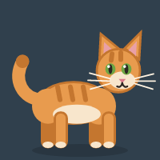
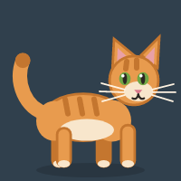
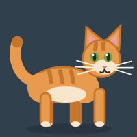
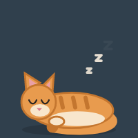
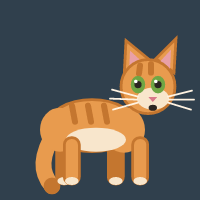
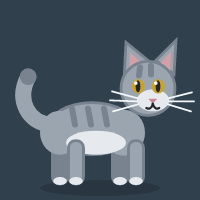
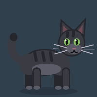
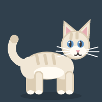

Catomania
=========

Catomania is a small Avalonia desktop for those who wants to add a cat into your screen! A kitty chases the mouse cursor across the screen.

## Features

1. Runs locally on Windows, macOS and Linux (X11, KDE Plasma and GNOME on Wayland, see [Linux and Wayland](#linux-and-wayland)).
2. The kitty walks and runs towards the cursor, stops nearby, looks around and falls asleep when the cursor does not move for a while.
3. The cat is drawn with vector shapes, so there are no image assets and it stays sharp at any size.
4. Four fur colors: ginger, gray, black and cream.
5. Drag the cat with the left mouse button, double-click it to pause, scroll the mouse wheel over it to change its size.
6. Right-click the cat for the menu: pause, speed, fur, size, always on top, recenter, check for updates and quit.
7. Settings are saved between runs in the user configuration directory.
8. Self-updates from the Velopack release feed when installed.

| Idle | Walk | Run | Sleep | Dragged |
| --- | --- | --- | --- | --- |
|  |  |  |  |  |

| Ginger | Gray | Black | Cream |
| --- | --- | --- | --- |
|  |  |  |  |

## Build & Run

Requires .NET 10.

```bash
dotnet build ./src/Catomania.sln
dotnet run --project ./src/Catomania
dotnet test ./src/Catomania.Tests
```

## Linux and Wayland

Wayland does not let applications read the global cursor position, and XWayland knows it only while the cursor is over an X11 window, that is, over the cat. So on Wayland Catomania asks the compositor:

- **KDE Plasma**: a small KWin script is loaded over D-Bus when the cat starts and unloaded when it quits. Nothing has to be installed.
- **GNOME**: the `catomania-cursor@catomania` GNOME Shell extension is installed into `~/.local/share/gnome-shell/extensions` and enabled on the first run. GNOME Shell on Wayland picks up new extensions only on login, so **log out and back in once** after the first run. If the cat still follows the cursor only nearby, check that the extension is enabled in the Extensions application. To remove it, run `gnome-extensions uninstall catomania-cursor@catomania`.

The extension and the script share only the cursor position. On other Wayland compositors the cat sees the cursor only when it is close by.

## Build & publish installers

The repository contains a Cake Frosting build script (`./build.sh`) that publishes self-contained single file binaries and packs them with [Velopack](https://velopack.io/):

```bash
./build.sh --target=Publish-Linux
./build.sh --target=Publish-Windows
./build.sh --target=Publish-Mac
```

Published binaries are placed to `./output/publish`, Velopack releases (setup, portable package and the update feed) to `./output/releases/<platform>`. The version is calculated by GitVersion and can be overridden with the `CATOMANIA_VERSION` environment variable (for example, `CATOMANIA_VERSION=1.2.3 ./build.sh --target=Publish-Linux`).

Prerequisites:

- The Velopack CLI: `dotnet tool install -g vpk`.
- On Linux additionally `squashfs-tools` for the AppImage package: `sudo dnf install squashfs-tools` or `sudo apt install squashfs-tools`.

## Updates

The application checks the Velopack release feed at `https://misc.anti-soft.ru/catomania/<platform>`, where `<platform>` is `win`, `linux` or `osx`:

- Right-click the cat and choose **Check for Updates**.
- Or run `Catomania --update-check`, optionally with `--update-url <uri>` to use another feed. The command prints the check result and exits, applying the update when one is available.

Self-update works when the application is installed by Velopack: on Linux run the packed `catomania.AppImage` (the updater replaces the AppImage file in place), on Windows run the installed setup. Development and portable builds only report the available version.

## Configuration

Settings are stored as JSON in the user configuration directory:

| OS | Path |
| --- | --- |
| Linux | `~/.config/Catomania/settings.json` |
| Windows | `%APPDATA%\Catomania\settings.json` |
| macOS | `~/Library/Application Support/Catomania/settings.json` |

| Field | Values | Default | Description |
| --- | --- | --- | --- |
| `speed` | `Slow`, `Normal`, `Fast` | `Normal` | How fast the cat chases the cursor. |
| `colorScheme` | `Ginger`, `Gray`, `Black`, `Cream` | `Ginger` | Fur color. |
| `size` | `Small`, `Medium`, `Large` | `Medium` | Cat size. |
| `alwaysOnTop` | `true`, `false` | `true` | Keep the cat above other windows. |
| `paused` | `true`, `false` | `false` | The cat stays in place and does not chase. |
| `sleepAfterSeconds` | number | `30` | Cursor inactivity before the cat falls asleep. |

## How it works

- `Views/CatWindow` is a small borderless transparent topmost window that hosts the cat.
- `Services/CatChaseService` runs a ~60 FPS loop on the UI thread: it reads the cursor position, advances the simulation and moves the window.
- `Input/ICursorPositionProvider` reads the global cursor position: `XQueryPointer` on X11, `GetCursorPos` on Windows and `CGEventGetLocation` on macOS. When the platform API is not available, the position reported by the pointer events of the cat window itself is used.
- `Simulation/CatSimulator` is the pure movement and animation state machine (idle, walk, run, sleep, dragged), it does not know anything about windows and is covered by unit tests.
- `Controls/CatView` draws the cat in a 100x100 design space scaled to the window, animating legs, tail, ears, eyes and blinks.

## Limitations

- On a native Wayland session without XWayland the global cursor position is not available, so the cat follows the pointer only while it is over the cat window.
- The cat window is a small rectangle; clicks inside the box but outside the drawn cat are captured by the window.

## License

Catomania is licensed under the MIT License - see the [LICENSE](LICENSE) file for details.
