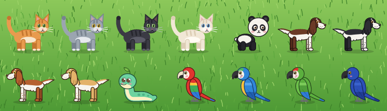

  

Catomania
=========

Catomania is a small Avalonia desktop for those who wants to add a cat into your screen! A kitty chases the mouse cursor across the screen.

  

## Features

1. Runs locally on Windows, macOS and Linux (X11, KDE Plasma and GNOME on Wayland, see [Linux and Wayland](#linux-and-wayland)).
2. The kitty walks and runs towards the cursor, stops nearby, looks around and falls asleep when the cursor does not move for a while.
3. The cat is drawn with vector shapes, so there are no image assets and it stays sharp at any size.
4. Five animals:
  - a cat with four fur colors (ginger, gray, black and cream)
  - a panda cub
  - a springer spaniel with four coats (liver, black, red and lemon on white)
  - a snake
  - a parrot with four macaw plumages (scarlet, blue and gold, green and hyacinth).
4. Settings are saved between runs in the user configuration directory.
5. Self-updates from the Velopack release feed when installed.

## Linux and Wayland

Wayland does not let applications read the global cursor position, and XWayland knows it only while the cursor is over an X11 window, that is, over the cat. So on Wayland Catomania asks the compositor:

- **KDE Plasma**: a small KWin script is loaded over D-Bus when the cat starts and unloaded when it quits. Nothing has to be installed.
- **GNOME**: the `catomania-cursor@catomania` GNOME Shell extension is installed into `~/.local/share/gnome-shell/extensions` and enabled on the first run. GNOME Shell on Wayland picks up new extensions only on login, so **log out and back in once** after the first run. If the cat still follows the cursor only nearby, check that the extension is enabled in the Extensions application. To remove it, run `gnome-extensions uninstall catomania-cursor@catomania`.

The extension and the script share only the cursor position. On other Wayland compositors the cat sees the cursor only when it is close by.

## Limitations

- On a native Wayland session without XWayland the global cursor position is not available, so the cat follows the pointer only while it is over the cat window.
- The cat window is a small rectangle; clicks inside the box but outside the drawn cat are captured by the window.

## License

Catomania is licensed under the MIT License - see the [LICENSE](LICENSE) file for details.
